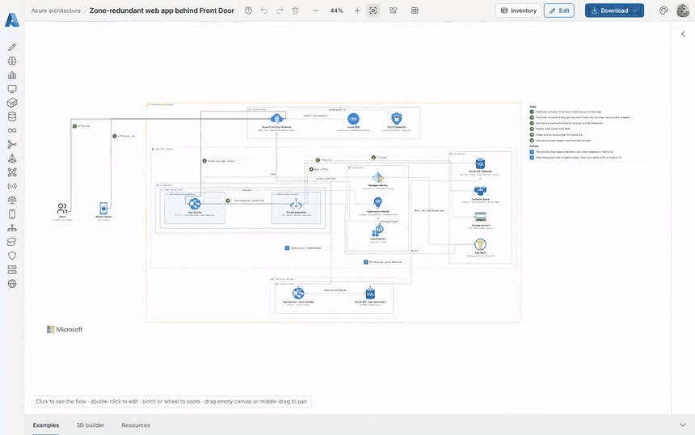

# Infragram Azure

Create and edit Azure, Kubernetes and Databricks infrastructure diagrams, import existing estates, review changes and costs, and export Azure Terraform.

One versioned `.infragram.json` document produces an offline HTML editor, SVG, PNG, draw.io and Terraform skeletons. The editor supports nested frames, layers, filtered views, automatic routing, saved layout and custom 3D components. Python authoring, a CLI and an MCP server use the same model.

This edition carries **three vendor libraries**: Azure, Kubernetes and Databricks. It has the same editor and exporter as the full Infragram product, plus `export:azure`, an Azure inventory importer the full product does not have.

[](docs/media/infragram-tour.mp4)

Number a wire with `Edge("HTTPS 443", step=1, says="...")` and it carries its number; click a card and the wires it joins light up, and the Steps panel lists each step's sentence. A second flow, here `Failover`, is drawn with blue squares. The [AKS baseline tour](docs/images/infragram-tour-azure-aks.gif) shows lenses, zoom and the dark theme. [Watch both (MP4)](docs/media/infragram-tour.mp4).

## What ships

| Library | Components | Frames |
|---|---:|---:|
| Azure | 715 | 11 |
| Kubernetes | 34 | 4 |
| Databricks | 78 | 4 |
| Shared primitives and core frames | 370 | 21 |

There are 827 vendor icons, 40 frames and four Azure starter templates. Counts are generated in [inventory.md](skills/infragram-azure/references/inventory.md). Shared primitives cover users, servers, databases, networks and common products for the estate around the cloud.

- **Build and edit:** Python diagrams, reusable patterns, project documents and an offline HTML editor.
- **Import:** Azure inventory, Kubernetes clusters, Terraform configuration/plan/state, draw.io, Mermaid, PlantUML, Excalidraw and Visio.
- **Review:** named and filtered views, visual diffs, Terraform plan actions and drift, policy checks and saved layout.
- **Estimate:** approximate Azure monthly list-price costs, itemized by frame and resource, with optional Infracost input.
- **Export:** HTML, SVG, PNG, draw.io, and Azure Terraform as plain resources or Azure Verified Modules.
- **Automate:** the same workflows through CLI commands, MCP tools and plugin hooks.

Terraform output is a skeleton with explicit variables and omissions to review. The tools validate and plan without automatically applying infrastructure. Cost estimates use stated or clearly marked assumed quantities; they do not represent an Azure bill or negotiated discounts.

## Start from a template

```powershell
uv tool install .
infragram new --template azure-hub-spoke-landing-zone
infragram export:project azure-hub-spoke-landing-zone.infragram.json --formats template,html,svg --renderer static
```

Open the exported HTML directly from disk to edit it. Add `png` after installing the optional browser dependencies:

```powershell
uv tool install ".[png]"
playwright install chromium
```

Install one edition per Python environment: the distribution is `infragram-azure`, while the import and command names remain `infragram`. Its plugin name is distinct from the full product's.

## Compose as Python

```python
from infragram.author import Diagram, Edge
from infragram.nodes import infragram as shared
from infragram.nodes.azure import compute, networking
from infragram.nodes.frames import azure as az

with Diagram("Azure web service", slug="azure-web-service"):
    users = shared.identity.PublicUsers("Users")
    with az.Subscription("Production"), az.ResourceGroup("rg-prod"):
        with az.VNet("vnet-prod 10.10.0.0/16"), az.Subnet("app 10.10.1.0/24"):
            gateway = networking.ApplicationGateways("Application Gateway")
            app = compute.VirtualMachine("App", "Standard_B2s").sizing(size="Standard_B2s")
    users >> Edge("HTTPS :443") >> gateway >> Edge("HTTP :8080") >> app
```

`infragram compose diagram.py` exports the file. Use `infragram find aks` to find component classes. [compose.md](skills/infragram-azure/references/compose.md) explains authoring; [patterns.md](skills/infragram-azure/references/patterns.md) covers reusable patterns and batch generation.

## Read Azure and Kubernetes

```powershell
az login
infragram export:azure --list-subscriptions
infragram export:azure -s "Production" -s "Connectivity" --view both --snapshot-out estate.json
infragram export:azure --from-snapshot estate.json --view network --formats template,html
infragram discover:kubernetes --context production
```

`export:azure` uses the Azure CLI's session to read Azure Resource Graph across selected subscriptions. Its network view places resources into their actual subnets; its groups view follows resource groups. It keeps peering endpoints in other subscriptions, tells subnet and NIC security attachments apart, and shows NSG, route-table and NAT gateway badges. Unknown resource types keep a generic icon and are listed in the summary. Snapshots can be replayed without credentials.

`discover:azure` reads one subscription into an editable diagram file and a report, and draws network security rules as traffic. Both only read the estate. See [azure-import.md](skills/infragram-azure/references/azure-import.md) and [terraform.md](skills/infragram-azure/references/terraform.md).

## Import, review and export infrastructure

```powershell
infragram import:terraform ./infra --no-export
infragram import:diagram architecture.drawio --formats template,html
infragram diff before.infragram.json after.infragram.json --report-only
infragram costs project.infragram.json --csv monthly-costs.csv
infragram check:policy project.infragram.json --strict
infragram export:project project.infragram.json --formats terraform,terraform-modules
infragram check:terraform project.infragram.json
```

Configuration, plan and state imports produce editable diagrams and a report. Plan imports show create, update, replace, destroy and drift actions. Policy checks review diagram exposure; Terraform folder scanning uses Checkov or Trivy when installed. A passing diagram check is not a complete security assessment.

[export.md](skills/infragram-azure/references/export.md) covers export formats, list-price assumptions and Infracost. Azure is the only provider this edition writes Terraform for.

## Commands

[//]: # (commands:start)

| Command | What it does |
|---|---|
| `new` | start a diagram file from a shipped example (or a document from a template with --template): its own title and slug, ready to compose |
| `templates` | list the shipped template documents: name, title, libraries, elements and connections; new --template starts from one |
| `compose` | run a Python diagram file and export it to HTML, SVG and PNG |
| `export:project` | render a .infragram.json document to HTML, SVG and PNG |
| `export:azure` | draw live Azure subscriptions or a saved snapshot, with network or resource-group views |
| `export:set` | export a folder of diagram files, one folder per diagram, checked, with the set's README |
| `find` | which class to import for a component: aks, load balancer, vnet; best match first, then the patterns; --library lists a whole library, --libraries the libraries |
| `recipes` | the 3D items drawn by spec: every recipe with its knobs, the families, colours and glyphs; one in detail, or drawn to an SVG with --svg |
| `diff` | what changed between two versions of a diagram, written out and drawn |
| `check:policy` | what a reviewer would stop in a diagram (a database in a public subnet, the internet reaching a database), and Checkov or Trivy on a Terraform folder when installed |
| `views` | list what --view can draw from a diagram: the views it declares, and every frame by level |
| `costs` | what a diagram costs a month, approximately, added up by frame: Azure priced from the shipped tables, --prices live, or an Infracost breakdown; --csv writes it out |
| `layout:save` | keep what was moved in the editor beside a diagram file, so compose draws it where it was left |
| `schema` | the JSON Schema of an .infragram.json document, for an editor's completion |
| `docs` | list the reference documents the skill ships (compose, frames, providers/azure...), print one, or --path to say where it is |
| `check` | check documents and exported pages: structure, real components, the picture itself, nothing remote |
| `check:terraform` | check that a diagram's Terraform works without deploying it: fmt, init and validate offline, then a plan against mocked providers |
| `verify:render` | render a diagram several times, prove the passes identical, and check the picture in both looks |
| `import:terraform` | draw what a Terraform configuration, plan or state declares: an editable diagram file, a report, and the diagram exported |
| `import:diagram` | draw a draw.io, Mermaid, PlantUML, Excalidraw or Visio diagram (or a Markdown page's blocks) as an editable diagram file, a report, and the diagram exported |
| `import:drawio` | import:diagram for a draw.io file: .drawio, .drawio.png, .drawio.svg, every page |
| `import:mermaid` | import:diagram for Mermaid: a .mmd file, or a Markdown page's mermaid blocks |
| `discover:azure` | draw a live Azure estate, read-only through the az CLI |
| `discover:kubernetes` | draw a live Kubernetes cluster, read-only through kubectl |
| `mcp` | serve these commands to an MCP client over stdio (the plugin's MCP server) |
| `hook:check` | the plugin's check hook: check a diagram an agent just wrote (event JSON on stdin) |
| `plugin:install` | register the plugin this copy carries with Claude Code, Codex or Pi |
| `plugin:path` | print the plugin folder this copy carries |

The maintainer commands need a checkout of the repository; `infragram --help` lists them, and [Development and scope](#development-and-scope) says which to run when.

[//]: # (commands:end)

`infragram mcp` serves these workflows over stdio. It includes `export_azure` for multi-subscription inventory and snapshot replay, alongside import, diff, costs, checks and normal exports.

## Install the agent plugin

Use this repository's absolute path in place of `<path-to-infragram-azure>`.

```text
# Claude Code
/plugin marketplace add <path-to-infragram-azure>
/plugin install infragram-azure@infragram-azure

# Codex
codex plugin marketplace add <path-to-infragram-azure>
codex plugin add infragram-azure@infragram-azure

# Pi
pi install <path-to-infragram-azure>
```

Once installed, the plugin adds these commands: `compose`, `export-project`, `export-azure`, `import`, `discover`, `check` and `check-terraform` (in Claude Code, `/infragram-azure:compose` and so on). A hook checks each diagram an agent writes, and the `diagram-reviewer` agent reviews a finished one.

The skill is [SKILL.md](skills/infragram-azure/SKILL.md). The standalone checker is standard-library Python; the package needs Python 3.11+ and pydantic. Browser rendering uses Playwright and Chromium.

## Development and scope

```powershell
uv sync --extra test
python -m pytest tests/unit tests/skill
infragram verify:all
```

See [CONTRIBUTING.md](CONTRIBUTING.md) for repository layout and development gates, and [scope.md](docs/architecture/scope.md) for the supported workflows. The Azure edition keeps its three vendor packs; other vendors' artwork remains in the full product. General editorial diagramming and automatic deployment are outside this edition's scope.

## Provenance and licenses

The code is [MIT licensed](LICENSE). Vendor artwork keeps its source, terms and hashes in each pack's catalog; see [THIRD_PARTY_LICENSES.md](THIRD_PARTY_LICENSES.md). Azure artwork follows Microsoft's architecture-icon terms, Kubernetes artwork follows its upstream and trademark terms, and the Databricks pack includes its MIT notice and applicable trademark terms. This edition carries no `vendor-unverified` packs.
