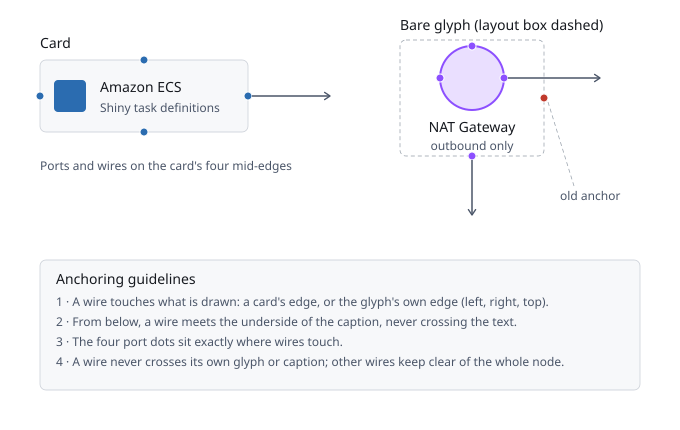
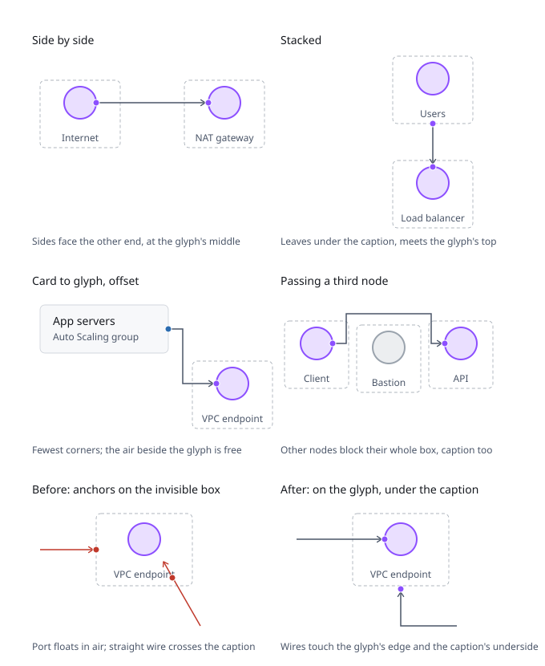

# ADR 0006: A wire touches what is drawn

**Status**: accepted, 2026-09-05

## Context

Every node occupies a box the layout reserves for it, and until now every
wire met that box: a connector left from a mid-edge of the box and the four
port handles sat on its corners' midpoints. For a card that is right -- the
box is the drawing. For an icon-only node it is wrong. A bare
glyph is drawn as a 64 px mark with its caption beneath, inside a box wide
enough for the caption (144 x 116 or more). A wire that met that box started
in empty air forty pixels beside the glyph, the port handle floated there
too, and a caption could be crossed by its own wire. It looked tacky, and
on a phone it read as a broken drawing.

## Decision

The anchoring guidelines, applied identically by the editor runtime and the
static renderer (the same drawing ships in the skill as
`references/connector-anchors.svg`):

1. **A wire touches what is drawn.** It meets a card at the card's edge. It
   meets a bare glyph at the mark's own edge: left and right at its vertical
   middle, top at its top. Never the invisible box, and never the air inside
   the glyph square either -- most artwork keeps some (the globe primitive
   leaves 9 px of a 64 px square on every side), so every icon's ink is
   measured into `assets/catalog/ink-profiles.json`: its bounding box, which
   the glyph box is drawn in to, and where the drawing begins along 33 lines
   of every side. A wire end on the box is then *seated*: pushed straight in
   along its own line to where the drawing begins, so a round or uneven mark
   is met on its outline, not in the air beside it. An end
   that falls on a gap in the mark -- between two people, beside a wifi arc
   -- first slides along the side to the nearest line the drawing reaches.
   Both renderers write the box onto the node as `data-ink` and the lines as
   `data-ink-edge`, and the checker holds every wire end to the drawing on
   its own line. (Amended 2026-09-11: until then one box per side held every
   end, and links spread along a round or notched mark floated in the air
   beside it or ran back over it.) What a wire touches is the *device*: a
   line whose first ink is a detail -- a separate piece under a third of the
   largest, like the wifi arcs over a router -- counts as a line with no
   ink, so a link slides past it to the device rather than landing on the
   decoration or running through it. The glyph box still covers every
   piece, so other wires keep clear of the details as well. A dashed
   outline is an edge: a line that passes between two dashes of a straight
   dashed edge is held at the dashes' depth, and the dashes are what a wire
   seats on. Ink that begins past the middle of the square is no seat
   either; a point there stays on the box's own edge. Where
   two neighbouring measured lines differ by more than a step, a point
   between them moves onto the nearer line, so it seats on that line's own
   edge rather than in the air beside it.
2. **From below, a wire meets the caption's underside.** The bottom anchor of
   an icon-only node is the bottom of the node, centred under the glyph, so a
   wire arriving from below never crosses the caption text.
3. **Ports sit where wires touch.** The four handles draw at the same points
   the wires use, so what an author drags from is where the wire will leave.
   Every wire on a side meets at that side's one port: a node has four
   connection points, not a row of them fanned along an edge like a circuit
   board. On a bare glyph the port sits at the middle of the stretch of that
   side the device's drawing reaches, so a wire meets the middle of a
   router's body, not the middle of its body and wifi arcs together. (Amended 2026-09-11: the editor used to spread several wires along
   a side, and made a crowded card taller to fit them.)
4. **A wire never crosses its own glyph or caption.** For its own two nodes
   a wire treats the glyph box and the caption band as hard obstacles at
   their true size; the air beside the glyph is free, which is how the wire
   leaves and arrives.
5. **Other wires keep clear of the whole node.** For every node that is not
   one of its two ends, a wire treats the full box -- glyph and caption --
   as an obstacle with the usual clearance.
6. **Sides face the other end.** The side is chosen from the relative
   position of the two nodes; when that pair is boxed in, every other pair
   of the ports left on auto is tried and the cleanest kept: no crossings
   first, then fewest corners, then shortest, horizontal pairs before
   vertical because they read best. A side is never paired with itself:
   that wire would wrap around the node.
7. **The straight path is the last resort**, used only when no routed pair
   is clear, and it obeys rule 1 too.
8. **A wire leaves straight out and arrives straight in.** Its first and
   last segments are perpendicular to the sides they touch and at least one
   stub long -- 20 px, or the 12 px clearance when a neighbour sits that
   close: the route is searched between a point one stub outside either
   anchor and the anchors are spliced back on. A routed wire therefore
   never slides along a glyph's or a card's border to get in.
9. **There is one head, and it sits on a straight shaft.** The arrowhead is
   defined once, in `assets/catalog/arrowheads.json`, and read by the editor
   runtime (through the page the shell writes), the static renderer and the
   checker: 7 x 6 px, a fixed size whatever the stroke, its tip exactly on
   the node's edge, with 10 px of straight wire under it. The corner before
   a head gives up its rounding before it gives up the shaft, so a bend
   never runs into the head. The wire itself stops 2 px short of the tip
   and the marker reaches past the path's end by the same 2 px, so the
   stroke never pokes out of the point where the head is thinner than the
   line. A picture drawn with any other head fails the checker.

The rules applied to six cases, shipped beside the first drawing as
`references/connector-anchors-cases.svg`:

The geometry comes from one place per renderer: `anchorBox(node)` in the
runtime and `_anchors(node, scene)` in the static renderer, both computed
from the same node-drawing numbers (glyph size, caption offset), so the two
pictures agree and the picture checker can hold them to it.

## Enforcement

The shipped picture checker verifies rules 1 to 3, 8 and 9 on every exported
picture: each end of every connector must touch the drawn shape of its node
-- a card's edge, or a bare glyph's left, right or top edge, or the node's
underside beneath the caption -- within two pixels, the segment at that end
must run straight out of the side it touches, not along it, at least a
head's length of straight wire must run under every arrowhead, and every
marker in the picture must be the house head from the shared spec. Because the checker runs
in `infragram check`, `verify:render`, `compose --verify`, the golden
pictures and the CI export step, the rule holds on every generation path, in
both looks, for every template, and for any document a user exports. The
drawings illustrate; the checker enforces.

## Consequences

- Every template with bare glyphs redraws its wires and port handles; the
  golden pictures are relocked after the whole set passes the checker.
- A wire leaving a glyph sideways passes through the invisible part of its
  own box. That is intended; the checker judges crossings of glyphs, text,
  titles and other nodes' boxes, never of empty air.
- Adding a third display mode means adding its anchor rule to both
  functions, not scattering geometry through the routing code.
