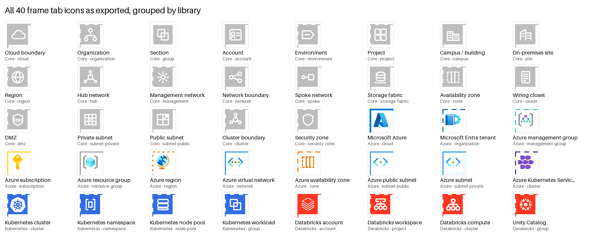
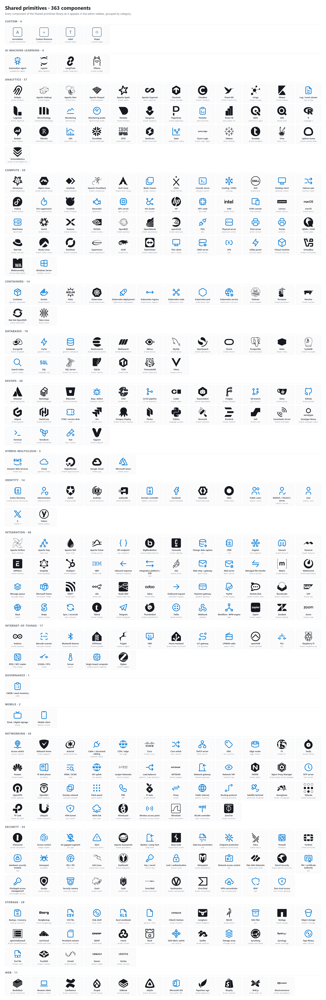
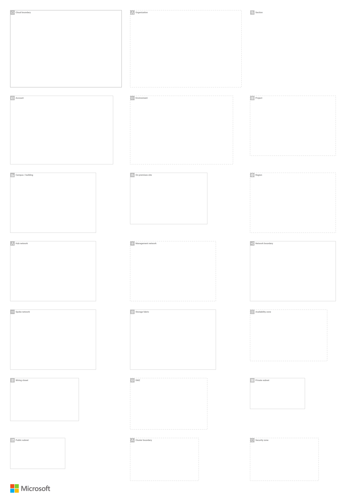
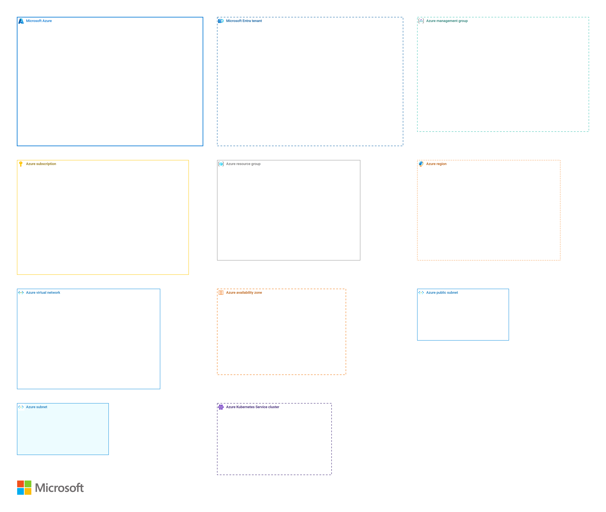
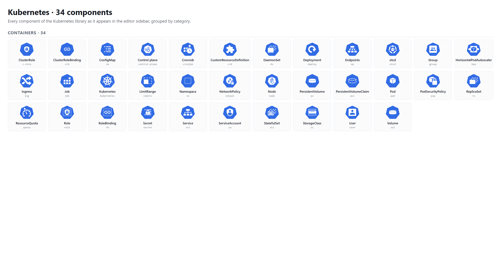
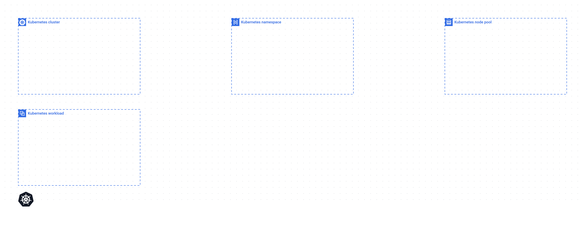
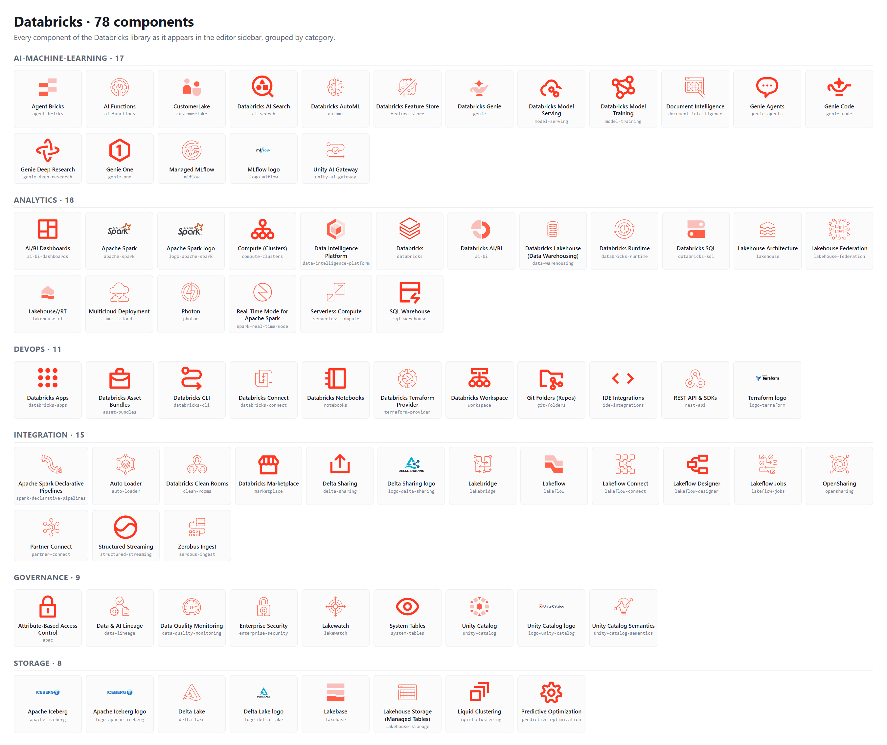
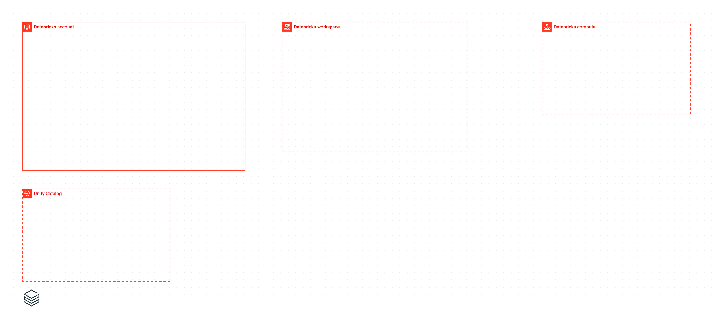

# Component inventory, with pictures

Every icon and every frame Infragram ships, drawn from the same library
payload the editor sidebar uses. Generated by
`python -m infragram inventory --images`; `infragram verify:all` fails when
this page is out of date or a picture is missing. Do not edit by hand.

**3 libraries · 827 vendor icons (30 still in the generic `custom` category) · 370 shared primitives · 40 frames in 4 groups · 3 starter stacks · 4 templates.**

## Libraries at a glance

| Library | Kind | Coverage | Icons | Unmapped | Frames | Starter stack |
|---|---|---|---:|---:|---:|---|
| Azure | cloud | full | 715 | 30 | 11 | Azure landing zone |
| Kubernetes | platform | reviewed | 34 | 0 | 4 | Kubernetes workload |
| Databricks | platform | reviewed | 78 | 0 | 4 | Databricks workspace |

*Unmapped* counts components the category map could not place in a
canonical category, so they sit under `custom` in the sidebar; mapping them
is catalog work, not missing artwork.

## Every frame tab

All 40 frame tab icons as the editor draws them, grouped by library.

## Shared primitives

370 neutral components available in every library: clients, users, generic servers and databases, networking, security, storage, brand marks and annotation shapes.

## Core frames

Provider-neutral frames for generic pictures: Cloud boundary (cloud), Organization (organization), Section (group), Account (account), Environment (environment), Project (project), Campus / building (campus), On-premises site (site), Region (region), Hub network (hub), Management network (management), Network boundary (network), Spoke network (spoke), Storage fabric (storage-fabric), Wiring closet (closet), Availability zone (zone), DMZ (dmz), Private subnet (subnet-private), Public subnet (subnet-public), Cluster boundary (cluster), Security zone (security-zone).

## Azure

cloud · full · 715 components · 11 frames · starter stack: Azure landing zone

Components by category: ai-machine-learning 48, analytics 38, compute 59, containers 15, custom 30, databases 43, devops 44, governance 79, hybrid-multicloud 26, identity 42, integration 42, internet-of-things 56, mobile 26, networking 72, power-platform 4, security 23, storage 34, web 34.

Frames: Microsoft Azure (cloud), Microsoft Entra tenant (organization), Azure management group (management-group), Azure subscription (subscription), Azure resource group (resource-group), Azure region (region), Azure virtual network (network), Azure availability zone (zone), Azure public subnet (subnet-public), Azure subnet (subnet-private), Azure Kubernetes Service cluster (cluster).

## Kubernetes

platform · reviewed · 34 components · 4 frames · starter stack: Kubernetes workload

Components by category: containers 34.

Frames: Kubernetes cluster (cluster), Kubernetes namespace (namespace), Kubernetes node pool (node-pool), Kubernetes workload (group).

## Databricks

platform · reviewed · 78 components · 4 frames · starter stack: Databricks workspace

Components by category: ai-machine-learning 17, analytics 18, devops 11, governance 9, integration 15, storage 8.

Frames: Databricks account (account), Databricks workspace (project), Databricks compute (cluster), Unity Catalog (group).

## Templates

| File | Title | Libraries | Elements | Frames | Wires |
|---|---|---|---:|---:|---:|
| `azure-aks-baseline.infragram.json` | AKS production baseline | azure | 32 | 15 | 19 |
| `azure-api.infragram.json` | Azure API reference | azure | 4 | 0 | 3 |
| `azure-hub-spoke-landing-zone.infragram.json` | Azure hub-and-spoke landing zone | azure | 51 | 24 | 29 |
| `azure-web-app-front-door.infragram.json` | Zone-redundant web app behind Front Door | azure | 27 | 11 | 18 |
